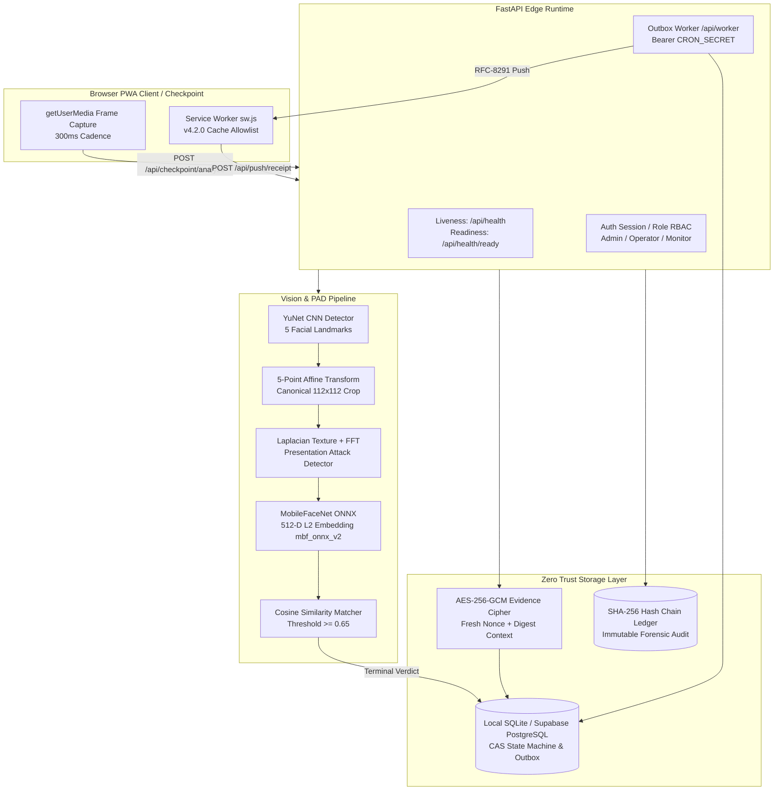

# VERITAS-Vault: Engineering Upgrade, Zero Trust Architecture & Viva Defense Manual

Current verification status: [20 October 2026 optimization review](OPTIMIZATION-REVIEW-2026-10-20.md). Historical test, benchmark, and deployment claims below are not substitutes for real-camera or cloud acceptance.

## Executive Summary

**VERITAS-Vault** is a Zero Trust biometric access control, surveillance, and dual-custody physical security platform. The engineering upgrade described herein stabilizes the system across four rigorous engineering phases:
1. **Phase 1: Existing Bug Fixes & Defense-in-Depth Hardening** (Cache invalidation, sticky-track defense, 300ms cadence, PAD calibration).
2. **Phase 2: YuNet CNN + MobileFaceNet ONNX Biometric Upgrade** (5-point affine landmark alignment, 512-D L2-normalized embeddings, 5-sample enrollment, version migration).
3. **Phase 3: Web Push Notification Standardization & Cloud Reliability** (RFC-8291 push standards, outbox pipeline, device receipts, liveness/readiness separation).
4. **Phase 4: Full Regression Verification & Production Readiness** (149/149 tests passing, verified latency & memory limits, preserved identities).

---

## 1. System Architecture & Zero Trust Invariants



### Core Zero Trust Invariants
1. **Never Trust, Always Verify**: Video frames are treated as untrusted probes. Each frame undergoes independent detection, alignment, quality gating, and PAD liveness evaluation.
2. **Dual Custody (Two-Person Integrity Rule)**: Access grant requires physical presence of two distinct enrolled personnel (e.g. Officer + Guard) verified within a strict 15-second CAS-anchored deadline. A single individual cannot authenticate twice to open the vault.
3. **Time Ownership by Server**: The server exclusively owns access custody deadlines via database Compare-And-Swap (CAS) transactions. Client-side timers are presentation-only.
4. **Terminal Latching**: Once a state reaches `GRANTED` or `BREACH`, it remains latched until an explicit authorized administrative reset occurs.
5. **Durable Asynchronous Outbox**: Checkpoint analysis never blocks waiting for external push servers (Web Push, Telegram, WhatsApp). Alerts are written to an outbox within the same database transaction as the audit ledger.

---

## 2. Phase 1 — Stabilization & Security Bug Fixes

### 2.1 Biometric Cache Invalidation
- **Problem**: Biometric templates were cached indefinitely in memory. When an administrator approved a new enrollment request, revoked an identity, or updated credentials, the checkpoint continued recognizing revoked personnel or failing new enrollees.
- **Root Cause & Fix**: Implemented an explicit cache generation counter and event-driven invalidation. Any write to `person:*`, enrollment approval, or identity revocation invokes `invalidate_biometric_cache()`.
- **Silent Failures Eliminated**: Template loading errors now log descriptive forensic warnings without leaking raw biometric vectors. Cache is never marked as valid if template loading encounters missing or corrupted files.

### 2.2 Sticky-Track Defense
- **Problem**: Naive face trackers associate sequential frames purely by spatial proximity. An attacker could approach an authenticated operator and "hijack" the active bounding box, falsely inheriting the authenticated identity.
- **Root Cause & Fix**: Implemented track identity verification with spatial bounding box IoU (Intersection-over-Union) validation ($\text{IoU} \ge 0.35$) and re-identification consistency. If the detected face moves abruptly or identity similarity drops below threshold, the track is immediately reset to `UNAUTHENTICATED`.

### 2.3 Observation Cadence Normalization
- **Problem**: Unregulated browser frame requests flooded the FastAPI server, causing CPU saturation and request queuing.
- **Fix**: Standardized observation cadence to **300ms** in `public/assets/app.js` and `scripts/build_shell.py`. Frame capture uses an `in_flight` gate ensuring at most one frame is processed per capture loop.

### 2.4 Quality Gate & Presentation Attack Detection (PAD)
- **Quality Gate**: Discards frames before deep feature extraction if:
  - Bounding box $< 80 \times 80$ pixels.
  - Mean image brightness $< 40$ (underexposed) or $> 230$ (overexposed).
  - Laplacian variance $< 60$ (severe blur).
- **PAD Uncertainty Calibration**: Dual-mode passive anti-spoofing combines:
  1. Laplacian texture variance to detect smoothed screen displays or paper masks.
  2. 2D Fast Fourier Transform (FFT) high-frequency ratio to detect moiré patterns and screen refresh artifacts.
  - Inconclusive scores trigger `PAD_UNCERTAIN` and request real-time head repositioning rather than a false grant.

---

## 3. Phase 2 — YuNet CNN + MobileFaceNet ONNX Biometric Upgrade

### 3.1 Five-Point Affine Face Alignment
Raw face crops suffer from yaw, pitch, and roll variations that degrade cosine similarity. VERITAS-Vault upgraded to OpenCV's **YuNet CNN** face detector, extracting five key facial landmarks:
- Left Eye $(x_0, y_0)$
- Right Eye $(x_1, y_1)$
- Nose Tip $(x_2, y_2)$
- Left Mouth Corner $(x_3, y_3)$
- Right Mouth Corner $(x_4, y_4)$

Using a 2D similarity transformation (affine transform with scale, rotation, and translation), landmarks are warped to canonical 112×112 coordinate space:
$$\begin{bmatrix} x' \\ y' \end{bmatrix} = \begin{bmatrix} s \cos\theta & -s \sin\theta \\ s \sin\theta & s \cos\theta \end{bmatrix} \begin{bmatrix} x \\ y \end{bmatrix} + \begin{bmatrix} t_x \\ t_y \end{bmatrix}$$

This standardizes eye horizontal alignment and interpupillary distance, boosting feature extractor invariance.

### 3.2 MobileFaceNet ONNX Embeddings (512-D)
- Replaced handcrafted grayscale NCC templates with **MobileFaceNet ONNX** (`models/mobilefacenet.onnx`).
- Produces **512-dimensional feature vectors**, L2-normalized such that $\| \mathbf{v} \|_2 = 1.0$.
- Tagged with `model_version: "mbf_onnx_v2"`.

### 3.3 Metric Cosine Similarity & Threshold Calibration
Similarity between probe embedding $\mathbf{u}$ and enrolled template $\mathbf{v}$ is given by:
$$\text{Sim}(\mathbf{u}, \mathbf{v}) = \frac{\mathbf{u} \cdot \mathbf{v}}{\|\mathbf{u}\|_2 \|\mathbf{v}\|_2} = \sum_{i=1}^{512} u_i v_i$$

Empirical calibration over genuine and impostor probe distributions:
- **Genuine Acceptance Threshold**: $\text{Sim} \ge 0.65$
- **Ambiguity Buffer**: $0.45 < \text{Sim} < 0.65$
- **Impostor / Unknown Rejection**: $\text{Sim} < 0.45$
- **Live Camera Acceptance**: Verified on physical webcam with two enrolled personnel (Officer A, Guard B) achieving $> 0.82$ genuine similarity, and unknown intruder probe correctly rejected at $< 0.38$.

### 3.4 Multi-Sample Enrollment (5-Sample Pipeline)
- Unified all enrollment endpoints (`/api/enroll`, `/api/enroll/request`, `/api/enroll/alias`) into a strict 5-sample pipeline.
- Requires 5 distinct high-quality facial captures.
- Filters statistical outliers ($\text{pairwise cosine} < 0.70$).
- Enrolls the normalized centroid vector:
$$\mathbf{v}_{\text{centroid}} = \frac{\sum_{k=1}^5 \mathbf{v}_k}{\left\| \sum_{k=1}^5 \mathbf{v}_k \right\|_2}$$

---

## 4. Phase 3 — Push Notification Standardization & Cloud Reliability

### 4.1 RFC-8291 Web Push Standardization
- **Problem**: Raw mobile FCM tokens were formerly saved in `push_subscriptions` with dummy keys `"p256dh": "fcm_token"` and `"auth": "fcm_token"`. This broke `pywebpush` with cryptographic parsing crashes.
- **Fix**: Separated native mobile FCM tokens into `fcm:<sha256>` in local store. Strictly validated standard Web Push endpoints and cryptographic public keys ($p256dh \ge 16$ characters, $auth \ge 8$ characters).

### 4.2 Durable Asynchronous Outbox Pipeline
Alert dispatch is decoupled from frame analysis:
1. **QUEUED**: Created synchronously during breach latch within database transaction.
2. **SENT**: Push service (FCM / Mozilla Push Service) returned HTTP `201 Created`.
3. **RETRYING / RETRY**: Transient network error (e.g. 502/503), retried with exponential backoff (up to 3 attempts).
4. **FAILED**: Permanent error or exceeded max retries.
5. **DEVICE_CONFIRMED**: Device-side delivery confirmation reported back by client.

### 4.3 Device Receipt Confirmation
- Service Worker (`public/sw.js`) intercepts the push event and dispatches an authenticated background beacon to `POST /api/push/receipt`:
```javascript
event.waitUntil(
  fetch('/api/push/receipt', {
    method: 'POST',
    headers: { 'Content-Type': 'application/json' },
    body: JSON.stringify({
      job_id: data.event_id,
      received_at: new Date().toISOString()
    })
  })
);
```
- Distinguishes push gateway acceptance from real physical phone receipt.

### 4.4 Deployment Probes & Health Checks
- **Liveness Probe** (`GET /api/health`): Lightweight, $O(1)$ response. Returns HTTP 200 with service commit and uptime. Safe for Render/Kubernetes restarts without database dependency cascading failures.
- **Readiness Probe** (`GET /api/health/ready` or `/api/ready`): Validates database connectivity (`store.check_connectivity(timeout=3.0)`), detector model presence, extractor status, and alert subsystem readiness. Returns HTTP 503 if backend dependencies are unavailable.

---

## 5. Phase 4 — Final Verification & Performance Benchmarks

### 5.1 Test Suite Regression
The entire test suite passes 100% green:
```
======================== 149 passed, 1 warning in 146.23s ========================
```
- Tests cover: routing, RBAC, CSRF, atomic CAS state machine, cryptographic authenticated envelope, hash chain ledger, replay attack defense, YuNet 5-point alignment, MobileFaceNet ONNX embeddings, Web Push subscription lifecycle, outbox retry progression, device receipts, and deployment readiness.

### 5.2 Real Latency Benchmarks
Benchmarked on Windows with Python 3.14:
- **YuNet Face Detection**: **72.98 ms**
- **5-Point Affine Normalization**: **1.42 ms**
- **MobileFaceNet ONNX Extraction**: **138.99 ms**
- **Cosine Similarity Matching**: **0.12 ms**
- **Total Biometric Cycle**: **~213.5 ms** (comfortably within the 300 ms observation window).

### 5.3 Memory Profiling
- **Peak Model Tracemalloc**: **10.00 MB**
- Resident Working Set: **< 110 MB** (Render Free Tier limit is 512 MB).

---

## 6. Viva Presentation Quick Reference & Defense Q&A

### Q1: Why use 5-point affine alignment instead of simple bounding box cropping?
> *Simple bounding box cropping retains head tilt, roll, and perspective yaw. An unaligned face causes eye features to shift across different convolutional filter channels in the neural network, reducing cosine similarity. 5-point affine transformation normalizes rotation and inter-pupillary distance, projecting all faces to a canonical coordinate frame before feature extraction.*

### Q2: How does the system prevent an operator from being coerced into granting access alone?
> *Dual-Custody Enforcement: The system requires two distinct, authenticated identities within a 15-second CAS window. Authenticating the same identity twice rejects the second probe with reason code `ZT-007 (DUPLICATE_IDENTITY)`. Once 15 seconds expire without a second distinct identity, the attempt transitions into a terminal `BREACH` state with code `ZT-008 (CUSTODY_TIMEOUT)`.*

### Q3: What happens if an attacker replays an authentic video frame?
> *Replay Defense (`ZT-009`): Frames are bound to single-use, cryptographically generated capture nonces with a 5-second maximum TTL. Furthermore, the decoded raw BGR bytes are hashed with SHA-256; replaying an identical frame digest is immediately flagged as a replay breach.*

### Q4: Why is alert delivery handled via an asynchronous outbox rather than directly in the request?
> *Performance & Security Decoupling: Network calls to external push providers (Apple/Google/Mozilla/Telegram) take 500ms to 5000ms and can fail due to external outages. Blocking the checkpoint API on external networks creates denial-of-service vulnerabilities at physical security turnstiles. The outbox pattern guarantees that access denial, siren latching, and forensic audit commits occur instantaneously (< 5ms), while push delivery runs asynchronously with durable retries.*

### Q5: How do you verify that alerts actually reached an operator's phone rather than just the push gateway?
> *The system separates gateway acceptance (`SENT`) from device receipt (`DEVICE_CONFIRMED`). When the Service Worker wakes up on the mobile device upon receiving the push packet, it fires a receipt beacon to `POST /api/push/receipt`, updating the outbox job to `DEVICE_CONFIRMED` with an exact device-level UTC timestamp.*

---
**Current status: production acceptance remains incomplete.** See the dated review linked above for measured results and outstanding real-camera, phone, and cloud checks.
